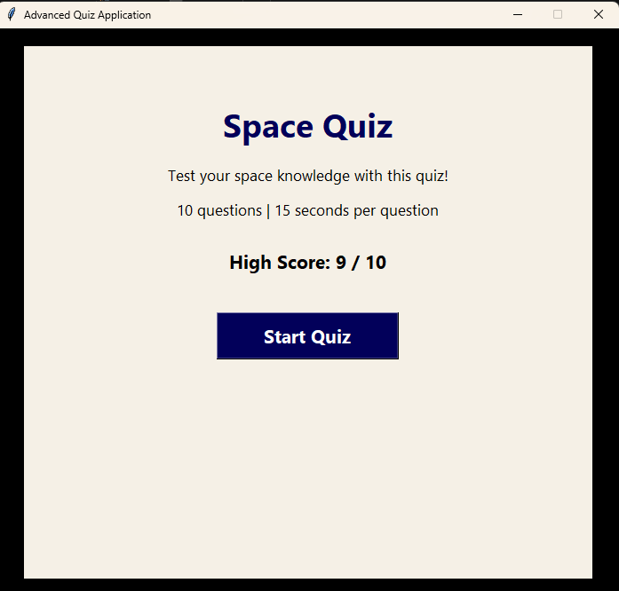
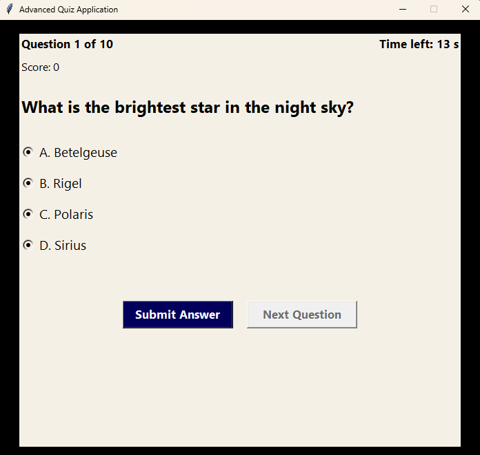
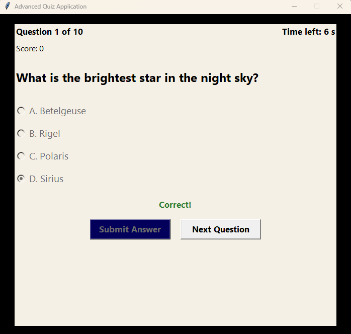
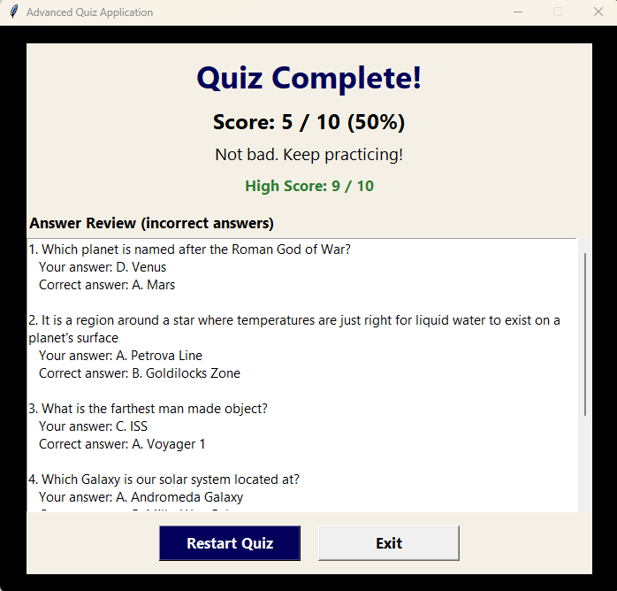
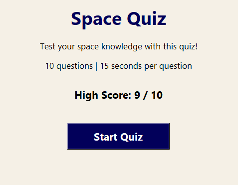

# Tkinter-Quiz-System

**Name:** Oswald Benedict N. Guevara
**Section:** SE 3A
**Topic:** Space
 
## Features Completed
	10 multiple-choice questions
	Random question order
	15-second countdown timer
	Answer checking and time-out handling
	Score and percentage
	Answer review
	High score saved in a text file
	Restart button
 
## How the Questions Are Stored and Shuffled
The questions are stored in a QUESTION array and is shuffled using the random.sample function
 
## How the Timer Works
The timer works by first defining how much time you want to put in the quiz, then if the question is answered it will return to the time_left which also has a value of TIME_LIMIT, if the timer runs out before you even
chose an answer, it will not let you choose an answer to that question and you don't get any points
 
## How the Program Identifies the Correct Answer
The submit_answer function identifies the correct answer by checking if your choice matches the answer from the answer part of the QUESTION array and will increment your point to 1.
 
## How the Score and High Score Work
The Score works by adding and assigning the score variable with 1. The high score works by first saving your first score as its high score, then if you play again and the current score you have is greater than
your current high score, your current score will now be the new high score.
 
## Function Explanations
| Function | Purpose | Called when |
|----------|---------|-------------|
| get_high_score() | fetches your high score from your txt file so that it saved into the application | it is called after beating your high score so that it records it to the txt file
| save_high_score() | Saves your high score to a txt file so that it wont disappear even after you've closed the application | called after finishing the quiz 
| clear_screen() | Clears all widget from the main frame | it is called when you open the application, started the quiz, and after finishing the quiz
| get_choice_text | fetches all the choices from the QUESTIONS array | it is called when you start the quiz and when the application wants to print the choice of your answer
| show_start_screen | shows the starting screen of the application | called right after you run the program
| start_quiz() | initiates the quiz game | called when you press the start quiz from the start screen
| show_question() | it shows a question from the QUESTIONS array | it is called when you start the quiz and when you go to the next question
| update_timer() | it acts as the countdown timer for the question and will change color if it is getting close to zero. It will only reset if the user answers the question and moves on to the next | called when the quiz starts.
| stop_timer() | stops the timer from counting down | called when the user answers a question and when the user closes the application
| lock_choices() | disables the choices from being chosen | called when the timer runs out and when the user has answered the question
| submit_answer() | submits the chosen answer of the user and checks whether the choice is correct or wrong | called when the user submits their answer
| time_up() | When the timer runs out, you cannot submit your answer and will be recorded as wrong | called when the timer runs out
| next_question() | proceeds to the next question | called when the user clicks the next question button
| show_results() | it shows the results of your quiz. It also checks if you passed or failed the quiz and you can also review the questions you got wrong | When the user is done with all the questions and clicked the see results button
| restart_quiz() | basically the start_quiz() method where it restarts the whole quiz and reshuffles the questions | When the user clicks the restart quiz from the results section
| on_close() | exits the application from the results section | calls when you want to exit the application from the results section of the application

 
## Screenshots

 
## Challenges I Faced
I have to manually format each labels and buttons
There are errors that are not identified by the IDE but when you run the application, there is something wrong with it
You have to do additional coding if you want your application to have an image
